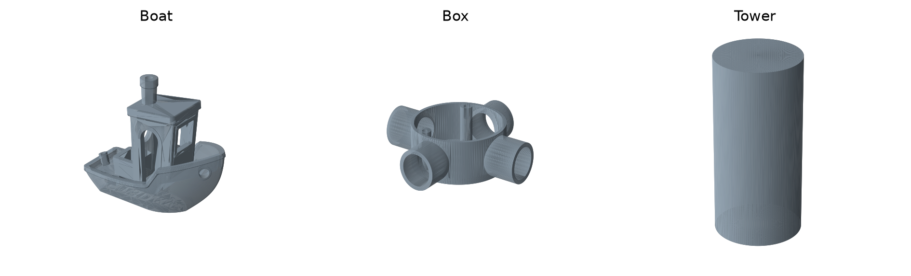

# No Fix — CSAW Hack3D 2026 Qualifier

We used three incomplete PLY scans to identify and rebuild a boat, an electrical connector enclosure, and a cylindrical tower. This repository contains the code, reconstructed models, and a public copy of our qualifier report.



| Part | Reconstruction | Overall size (mm) |
| --- | --- | --- |
| Boat | Identified and cleaned the official 3DBenchy mesh | 60 × 31 × 48 |
| Box | Modeled a round body, four side ports, and two mounting bosses from scan measurements | 98 × 92 × 27 |
| Tower | Fitted a cylinder to the scan | ⌀12.5 × 24.2 |

- [Qualifier report (PDF)](docs/Qualifier_Report.pdf) explains how we found the clues, rebuilt the parts, and evaluated the material evidence.
- [Dimension drawings (PDF)](docs/Drawings.pdf) includes orthographic views for all three models.
- [CAD](cad/) contains the three STL meshes. [Results](results.json) records their dimensions, volume, and mesh checks.

The Box uses smooth bores because the scan did not resolve the threads. The report also distinguishes inferred materials from materials we selected for reproduction. We checked the digital models; we did not print them.

## Rebuild the models

We used Python 3.12:

```bash
python -m pip install -r code/requirements.txt
python code/No_Fix_Submission.py
```

The script uses the included Benchy reference and our recorded Box and Tower dimensions to recreate the STL files in `cad/` and update `results.json`. If you already have the organizer's original PLY files, you can pass `--scans /path/to/scan-folder` to read all three scans and refit Tower. Box still uses our recorded measurements.

The organizer's original scans, problem statement, and clue attachments are not redistributed here. The public report also omits the challenge archive's password.

The [3DBenchy reference model](https://github.com/CreativeTools/3DBenchy) was designed by Daniel Norée at Creative Tools. It is included under [3DBenchy's CC0 license](https://www.3dbenchy.com/license/). The qualifier is organized by [CSAW Hack3D](https://csaw.io/competition/hack3d).
